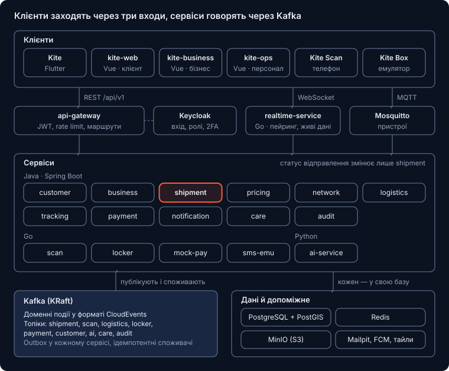

# 05 · Архітектура і карта сервісів

> **Kite** — документація поштової системи · v1.4 · затверджено · 14.11.2026

Kite — це 12 сервісів на Java (Spring Boot 3, Java 21), 5 на Go і 1 на Python (плюс симулятор), які спілкуються синхронно через REST за шлюзом і асинхронно через Kafka. Кожен сервіс володіє своєю базою; статус відправлення змінює тільки shipment-service, решта реагує на його події.

*карта сервісів · клієнти, входи, сервіси, брокер, дані*

Запити йдуть зверху вниз через один із трьох входів; після цього сервіси не викликають один одного напряму, а обмінюються подіями через Kafka (винятки — розрахунок ціни й пошук маршруту).

## 5.1 Сервіси

| Сервіс               | Мова                        | Відповідальність                                                                               | Сховище                                |
| -------------------- | --------------------------- | ---------------------------------------------------------------------------------------------- | -------------------------------------- |
| api-gateway          | Java (Spring Cloud Gateway) | Єдина точка входу, перевірка JWT, rate limit, маршрутизація                                    | Redis                                  |
| Keycloak             | — (готовий продукт)         | Користувачі, ролі, OTP, 2FA персоналу, клієнти OAuth                                           | Postgres                               |
| customer-service     | Java                        | Профілі, мультиномер, довірені особи, улюблені точки, налаштування                             | Postgres `customer`                    |
| business-service     | Java                        | Організації, учасники, API-ключі, вебхуки, імпорт CSV, реєстри                                 | Postgres `business`                    |
| shipment-service     | Java                        | Накладні, місця, стейт-машина, керування доставкою, повернення, саги                           | Postgres `shipment`                    |
| pricing-service      | Java                        | Тарифи, розрахунок вартості, промокоди                                                         | Postgres `pricing` + Redis             |
| network-service      | Java                        | Відділення, Kite Box (довідник), хаби, лінії сортування, таблиця маршрутизації, розклад рейсів | Postgres + PostGIS `network`           |
| logistics-service    | Java                        | Мішки й контейнери, рейси, маніфести, розбіжності                                              | Postgres `logistics`                   |
| tracking-service     | Java                        | Журнал подій, таймлайн, дашборди «мені / від мене», публічне відстеження                       | Postgres `tracking` (партиції) + Redis |
| payment-service      | Java                        | Платежі, повернення коштів, післяплата, виплати, бали, проводки                                | Postgres `payment`                     |
| notification-service | Java                        | Шаблони, вибір каналів, доставка push / email / SMS                                            | Postgres `notification`                |
| care-service         | Java                        | Претензії і тікети підтримки                                                                   | Postgres `care` + MinIO (фото)         |
| audit-service        | Java                        | Журнал дій персоналу і доступів до персональних даних                                          | Postgres `audit`                       |
| scan-service         | Go                          | Прийом сканів (HTTP, MQTT), валідація, реєстр сканерів, сортувальна підказка                   | Postgres `scan` + Redis                |
| realtime-service     | Go                          | WebSocket: пейринг телефону з Kite Ops, живі оновлення таймлайну і дашбордів                   | Redis                                  |
| locker-service       | Go                          | Емулятор Kite Box: комірки, коди, команди відкриття через MQTT                                 | Postgres `locker`                      |
| mock-pay             | Go                          | Емулятор платіжного провайдера: сторінка оплати, 3-D Secure, вебхуки                           | Postgres `mockpay`                     |
| sms-gateway-emu      | Go                          | Емулятор SMS-шлюзу з веб-інтерфейсом «телефону»                                                | SQLite                                 |
| ai-service           | Python (FastAPI)            | Прогноз дати доставки, ризик невдалої доставки; у v2 — фото → накладна, пошкодження, асистент  | Postgres `ai` + файли моделей          |
| simulator            | Python                      | Рух посилок мережею (окремий етап)                                                             | —                                      |

## 5.2 Клієнтські застосунки

| Застосунок      | Стек                                                 | Що містить                                             |
| --------------- | ---------------------------------------------------- | ------------------------------------------------------ |
| kite-web        | Vue 3, Vite, TypeScript, Pinia, Vue Router, vue-i18n | Клієнтський кабінет і публічне відстеження             |
| kite-business   | Vue 3 (той самий UI-кит)                             | Кабінет Kite Business                                  |
| kite-ops        | Vue 3 (той самий UI-кит)                             | Робочі місця персоналу, адмінка, диспетчерська         |
| kite-box-screen | Vue 3                                                | Екран поштомату для емулятора Kite Box                 |
| kite-mobile     | Flutter 3, Riverpod, go_router, Dio, mobile_scanner  | Клієнтський застосунок + режим Kite Scan для персоналу |

Спільний UI-кит `@kite/ui` (Vue-компоненти + дизайн-токени) живе в окремому репозиторії `kite-ui` і приходить у веб-застосунки як npm-пакет із GitHub Packages, закріплений за версією; ті самі токени генеруються для Flutter.

## 5.3 Інфраструктура

- **Брокери:** Kafka (режим KRaft, без ZooKeeper) для доменних подій; Mosquitto (MQTT) для пристроїв — Kite Box і стаціонарних сканерів-заглушок.
- **Дані:** один контейнер PostgreSQL 16 з PostGIS і окремою базою на кожен сервіс; Redis для кешу, rate limit і сесій пейрингу; MinIO як S3 для етикеток PDF, фото і моделей.
- **Карти:** MapLibre GL у Vue і Flutter, векторні тайли України у файлі PMTiles (Protomaps), які роздає локальний nginx; геокодер Photon з українським вилученням OpenStreetMap. Усе безкоштовне, локальне і повністю стилізується під бренд.
- **Сповіщення:** web push через стандарт VAPID (без сторонніх сервісів); мобільний push через Firebase Cloud Messaging — для iOS у проєкт FCM завантажується ключ APNs; email ловить Mailpit (видно справжні листи у веб-інтерфейсі); SMS — sms-gateway-emu.
- **Спостережуваність:** OpenTelemetry Collector → Tempo (трейси), Prometheus (метрики), Loki (логи), Grafana.

## 5.4 Патерни взаємодії

1. **База на сервіс.** Жодних спільних таблиць; дані інших сервісів — через API або локальні проєкції з подій.
2. **Transactional outbox.** Сервіс пише зміну і подію в одній транзакції у таблицю `outbox`, окремий процес публікує її в Kafka. Це гарантує, що подія не загубиться і не з'явиться без зміни.
3. **Ідемпотентні споживачі.** Кожен споживач тримає таблицю `processed_event(event_id)` і пропускає повтори.
4. **Сага-оркестрація** в shipment-service для «створити → порахувати → оплатити → підтвердити» і для повернень, з компенсаціями (скасування платежу, звільнення комірки).
5. **CQRS у tracking-service.** Запис — журнал подій, читання — готові проєкції (таймлайн, «мої відправлення», публічний статус).
6. **Формат подій** — CloudEvents у JSON; схеми (JSON Schema) у репозиторії `kite-contracts`, з нього генеруються Java-класи, Go-структури і Dart-моделі. Сервіси підключають їх як залежність, закріплену за тегом, а не копіюють до себе.
7. **Синхронні виклики між сервісами** — мінімальні: розрахунок ціни і пошук маршруту (з кешем). Тайм-аути 2 с і circuit breaker (Resilience4j).

## 5.5 Головний потік: скан у хабі

1. Сортувальник сканує посилку телефоном у режимі Kite Scan; телефон спарений з його сесією в Kite Ops.
2. scan-service перевіряє скан (дубль, чи очікувалась посилка в цьому хабі), рахує сортувальну підказку з таблиці маршрутизації і публікує `scan.recorded`.
3. shipment-service застосовує подію до стейт-машини (AT_HUB → SORTED) і публікує `shipment.status-changed`.
4. tracking-service дописує подію в журнал і оновлює проєкції; ai-service перераховує прогноз.
5. realtime-service показує підказку «лінія 7 → Львів» на екрані Kite Ops і на телефоні; клієнт, який дивиться таймлайн, бачить новий крок без оновлення сторінки.

## 5.6 Репозиторії

Спільного репозиторію немає: кожен сервіс, застосунок і бібліотека живе у власному репозиторії однієї організації на GitHub. Ім'я репозиторію дорівнює імені сервіса (`shipment-service`), ім'я образу — `ghcr.io/<організація>/shipment-service`. Збирає все докупи не код, а готові образи: репозиторій-оркестратор `kite-infra` тягне їх із GitHub Container Registry за зафіксованими тегами (деталі — у 12.6).

| Репозиторій                                                                                                                   | Що всередині                                                                             | Що публікує                               |
| ----------------------------------------------------------------------------------------------------------------------------- | ---------------------------------------------------------------------------------------- | ----------------------------------------- |
| kite-contracts                                                                                                                | OpenAPI, JSON Schema подій, генератори клієнтів                                          | Maven-пакет, Go-модуль, Dart-пакет        |
| gateway, customer, business, shipment, pricing, network, logistics, tracking, payment, notification, care, audit (`-service`) | 12 сервісів на Java — по репозиторію на сервіс                                           | Docker-образ                              |
| scan, realtime, locker, mock-pay, sms-gateway-emu (`-service`)                                                                | 5 сервісів на Go                                                                         | Docker-образ                              |
| ai-service, simulator                                                                                                         | Python                                                                                   | Docker-образ                              |
| kite-web, kite-business, kite-ops, kite-box-screen                                                                            | 4 веб-застосунки на Vue                                                                  | Docker-образ зі зібраною статикою в nginx |
| kite-ui                                                                                                                       | UI-кит: Vue-компоненти і дизайн-токени                                                   | npm-пакет у GitHub Packages               |
| kite-mobile                                                                                                                   | Flutter: клієнтський застосунок і Kite Scan                                              | APK та IPA у релізах, без образу          |
| kite-infra                                                                                                                    | Оркестратор: compose з профілями, Keycloak realm, дашборди Grafana, сид, тайли, Makefile | Нічого не збирає — тягне чужі образи      |
| kite-docs                                                                                                                     | Ця документація і ADR                                                                    | GitHub Pages                              |
| .github                                                                                                                       | Спільні reusable-workflow і шаблони репозиторіїв                                         | —                                         |

Разом близько 27 репозиторіїв. Ціна такого поділу — наскрізна зміна, яка торкається кількох із них, тож порядок завжди однаковий: спершу адитивна зміна в `kite-contracts` з новим тегом, потім споживачі, і тільки потім продюсер починає слати нове поле. Щоб 27 репозиторіїв не розповзлися в різні боки, Dockerfile, лінтери й пайплайни не копіюються руками: нові репозиторії створюються з шаблону, а CI викликає спільні workflow з репозиторію `.github`.

---

[← 04 · Нефункціональні вимоги](../02-vymohy/04-nefunktsionalni-vymohy.md) · [Зміст](../README.md) · [06 · Схема бази даних →](06-skhema-bazy-danykh.md)
