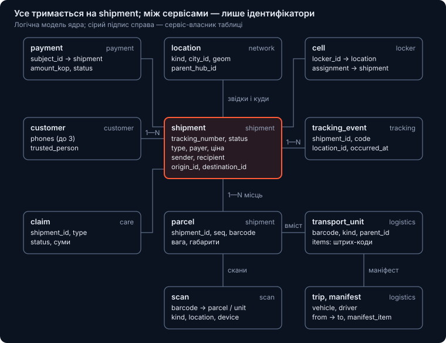

# 06 · Схема бази даних

> **Kite** — документація поштової системи · v1.4 · затверджено · 17.11.2026

Кожен сервіс має власну базу в PostgreSQL 16; разом це близько 60 таблиць. Між базами немає зовнішніх ключів — лише ідентифікатори (UUID), які узгоджуються через події. Міграції кожен сервіс везе у своєму репозиторії й накочує сам; зведений DDL усіх баз лежить у `kite-docs` як довідка — нижче те саме коротко: що де лежить і головні поля.

*логічна ER-модель ядра · 11 таблиць, 8 сервісів*

Зв'язки на діаграмі логічні: між сервісами немає зовнішніх ключів, тож цілісність тримають події і перевірки в коді; всередині однієї бази (shipment → parcel) — звичайні FK.

## 6.1 Домовленості

- Первинні ключі — UUID v7 (впорядковані за часом, генеруються в застосунку).
- Гроші — `bigint` у копійках, валюта завжди UAH; вага — у грамах, розміри — у міліметрах.
- Час — `timestamptz` в UTC; у застосунках показуємо Europe/Kyiv.
- Переліки — `text` з `CHECK`, а не типи `enum` у Postgres: їх простіше розширювати міграціями.
- Оптимістичне блокування — колонка `version` у сутностей, що змінюються конкурентно (відправлення, комірка, мішок).
- У кожній базі є `outbox` (вихідні події) і `processed_event` (вже оброблені вхідні).
- Міграції — Flyway у Java-сервісах, golang-migrate у Go, Alembic у Python.

## 6.2 Таблиці по сервісах

| Сервіс       | Таблиця                                    | Призначення і ключові поля                                                                                                                                                                                                        |
| ------------ | ------------------------------------------ | --------------------------------------------------------------------------------------------------------------------------------------------------------------------------------------------------------------------------------- |
| customer     | customer                                   | Профіль: keycloak_user_id, ПІБ, email, locale, theme, тиха година                                                                                                                                                                 |
| customer     | customer_phone                             | Мультиномер: phone (E.164, унікальний), is_primary, verified_at; до 3 на клієнта                                                                                                                                                  |
| customer     | trusted_person                             | Довірені особи: ПІБ, телефон                                                                                                                                                                                                      |
| customer     | saved_address, favorite_point              | Улюблені точки                                                                                                                                                                                                                    |
| customer     | notification_preference, push_subscription | Канали за типом події; підписки web push і FCM                                                                                                                                                                                    |
| business     | organization                               | Назва, ЄДРПОУ, IBAN, план, розклад виплат COD                                                                                                                                                                                     |
| business     | org_member                                 | Учасник і його роль в організації                                                                                                                                                                                                 |
| business     | api_key                                    | Префікс, хеш ключа, скоупи, ліміт частоти, revoked_at                                                                                                                                                                             |
| business     | webhook_endpoint, webhook_delivery         | Адреса, секрет HMAC, події; спроби доставки з next_attempt_at                                                                                                                                                                     |
| business     | import_job, registry, registry_item        | Імпорт CSV зі звітом; реєстри приймання-передачі                                                                                                                                                                                  |
| shipment     | shipment                                   | tracking_number (13 символів), type, status, відправник, отримувач, звідки, куди (відділення / Kite Box), payer, declared_value, cod_amount, вага до оплати, price_total, eta, return_of, storage_free_until, hold_until, version |
| shipment     | parcel                                     | Місце: seq, barcode (`KT…UA-01`), заявлені та фактичні вага й габарити                                                                                                                                                            |
| shipment     | shipment_service                           | Додаткові послуги: код, параметри, ціна                                                                                                                                                                                           |
| shipment     | shipment_route                             | Запланований маршрут: порядок, точка, тип (старт, хаб, фініш), плановий час                                                                                                                                                       |
| shipment     | delivery_action                            | Переадресація, відпустка, зміна отримувача, продовження, відмова: статус, ціна, хто запросив                                                                                                                                      |
| shipment     | authorized_recipient, pickup_code          | Хто може отримати конкретне відправлення; хеш коду видачі                                                                                                                                                                         |
| pricing      | tariff_version, tariff_rate                | Версії тарифів; ставка за тип × зону × вагову межу                                                                                                                                                                                |
| pricing      | service_price, promo_code, quote           | Ціни послуг; промокоди; кеш розрахунків на 15 хв                                                                                                                                                                                  |
| network      | region, city                               | Області й міста з кодами КАТОТТГ і координатами                                                                                                                                                                                   |
| network      | location                                   | Відділення, вантажне відділення, Kite Box, обласний СЦ, магістральний хаб: код, місто, адреса, `geography(Point)`, ліміт ваги, послуги, батьківський хаб                                                                          |
| network      | opening_hours                              | Графік по днях тижня                                                                                                                                                                                                              |
| network      | sort_line                                  | Лінії сортування хабу і їхній напрям                                                                                                                                                                                              |
| network      | routing_rule                               | Хаб + регіон або точка призначення → наступна точка і лінія; пріоритет                                                                                                                                                            |
| network      | linehaul_schedule                          | Розклад магістральних рейсів: звідки, куди, час відправлення, дні, тривалість                                                                                                                                                     |
| logistics    | transport_unit, transport_unit_item        | Мішок, контейнер, палета (з вкладенням одне в одне) і їхній вміст                                                                                                                                                                 |
| logistics    | vehicle, trip                              | Машини; рейси з плановими й фактичними часами, водієм і статусом                                                                                                                                                                  |
| logistics    | manifest, manifest_item                    | Маніфест рейсу: які одиниці мають бути в машині                                                                                                                                                                                   |
| logistics    | discrepancy                                | Розбіжності: нестача, зайве, пошкодження, неправильне сортування                                                                                                                                                                  |
| tracking     | tracking_event                             | Журнал подій (партиції по місяцях): код події, статус після, точка, час події і запису, джерело, деталі, код UPU EMSEVT                                                                                                           |
| tracking     | shipment_view                              | Проєкція для швидкого читання: статус, прогноз, публічні поля                                                                                                                                                                     |
| tracking     | party_shipment_index                       | Хеш телефону → відправлення, напрям (мені / від мене), архів — для дашборда                                                                                                                                                       |
| tracking     | external_tracking                          | Сторонні номери клієнта з підписом і ручним статусом                                                                                                                                                                              |
| payment      | payment, refund                            | Платіж: предмет оплати, платник, сума, спосіб, статус, ключ ідемпотентності, посилання провайдера                                                                                                                                 |
| payment      | cod, payout                                | Післяплата: зібрано, виплачено; пакетні виплати отримувачам                                                                                                                                                                       |
| payment      | ledger_entry                               | Подвійний запис: рахунок, дебет, кредит, посилання на операцію                                                                                                                                                                    |
| payment      | bonus_account, bonus_transaction           | Баланс балів; нарахування, списання, згорання                                                                                                                                                                                     |
| payment      | invoice                                    | Місячні рахунки для бізнесу                                                                                                                                                                                                       |
| notification | template, notification                     | Шаблони за каналом і мовою; журнал відправок зі статусом                                                                                                                                                                          |
| care         | claim, claim_attachment                    | Претензії: тип, суми заявлена й погоджена, статус, виконавець; фото в MinIO                                                                                                                                                       |
| care         | ticket, ticket_message                     | Тікети підтримки і повідомлення в них                                                                                                                                                                                             |
| audit        | audit_record                               | Хто, яка роль, яка дія, над чим, чи був доступ до персональних даних, IP, час                                                                                                                                                     |
| scan         | scanner_device                             | Телефон або стаціонарний сканер-заглушка: точка, спарений користувач, останній зв'язок                                                                                                                                            |
| scan         | scan                                       | Скан: id від клієнта (для ідемпотентності), штрих-код, тип операції, точка, пристрій, час, результат, код попередження                                                                                                            |
| locker       | locker, cell                               | Поштомат і комірки: код, розмір S/M/L, доступна зона, стан, version                                                                                                                                                               |
| locker       | cell_assignment, storage_booking           | Закріплення комірки за відправленням або камерою зберігання: хеш коду, термін, відкрито / закрито                                                                                                                                 |
| ai           | eta_prediction, risk_score, model_registry | Прогнози з інтервалом, оцінки ризику з причинами, версії моделей                                                                                                                                                                  |

## 6.3 Ключові індекси та обмеження

- `shipment(tracking_number)` унікальний; `parcel(barcode)` унікальний.
- `tracking_event(shipment_id, occurred_at)` — для таймлайну; партиціювання за `occurred_at`.
- `party_shipment_index(phone_hash, direction, archived)` — для дашборда «мені / від мене».
- `location` — GiST-індекс по `geom` для пошуку найближчих точок; `scan(location_id, scanned_at)`.
- `cell` — частковий індекс за станом `FREE` і розміром для швидкого резервування.
- `payment(idempotency_key)` унікальний; `customer_phone(phone)` унікальний.

---

[← 05 · Архітектура і карта сервісів](05-arkhitektura-i-karta-servisiv.md) · [Зміст](../README.md) · [12 · Інфраструктура і локальний деплой →](12-infrastruktura-i-lokalnyi-deploi.md)
