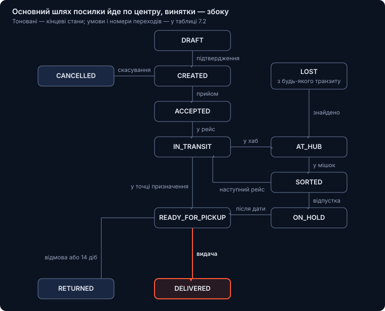

# 07 · Стейт-машина посилки

> **Kite** — документація поштової системи · v1.4 · затверджено · 17.11.2026

Статус має кожне місце (parcel) окремо, а статус відправлення — це статус найменш просунутого місця плюс прапорець «частково видано». Переходи виконує тільки shipment-service (Spring State Machine або власний табличний автомат); будь-який недозволений перехід відхиляється і пишеться в журнал як попередження.

*стейт-машина посилки · 12 станів*

Від прийому до видачі посилка йде центральною колонкою; цикл «хаб → мішок → наступний рейс» повторюється стільки разів, скільки хабів на маршруті.

## 7.1 Стани

| Стан             | Що означає                                                         | Видно клієнту як                                |
| ---------------- | ------------------------------------------------------------------ | ----------------------------------------------- |
| DRAFT            | Чернетка, не підтверджена                                          | «Чернетка»                                      |
| CREATED          | Накладну створено, чекає на прийом; можлива оплата онлайн          | «Створено, віднесіть у відділення або Kite Box» |
| CANCELLED        | Скасовано відправником до прийому (кінцевий)                       | «Скасовано»                                     |
| ACCEPTED         | Прийнято у відділенні чи Kite Box                                  | «Прийнято»                                      |
| IN_TRANSIT       | У машині між точками                                               | «Їде до {місто}»                                |
| AT_HUB           | Розвантажено в хабі, ще не відсортовано                            | «У сортувальному центрі {місто}»                |
| SORTED           | Відсортовано, лежить у мішку на лінії                              | «Готується до відправки»                        |
| ON_HOLD          | Утримання: «відпустка» клієнта або інцидент                        | «Утримується до {дата}»                         |
| READY_FOR_PICKUP | У відділенні чи комірці Kite Box, можна забрати                    | «Можна забирати»                                |
| DELIVERED        | Видано отримувачу (кінцевий)                                       | «Отримано»                                      |
| RETURNED         | Створено повернення; далі живе повернення (кінцевий для оригіналу) | «Повертається відправнику»                      |
| LOST             | Втрачено, підтверджено диспетчером                                 | «Шукаємо посилку»                               |

## 7.2 Переходи

| #     | Звідки                        | Тригер                                                 | Куди             | Хто ініціює                   | Умова                                                          |
| ----- | ----------------------------- | ------------------------------------------------------ | ---------------- | ----------------------------- | -------------------------------------------------------------- |
| `T1`  | DRAFT                         | Підтвердити                                            | CREATED          | Клієнт, бізнес                | Пройшла валідація, є ціна                                      |
| `T2`  | DRAFT, CREATED                | Скасувати                                              | CANCELLED        | Відправник                    | Ще не прийнято; онлайн-оплата повертається                     |
| `T3`  | CREATED                       | Скан ACCEPT у відділенні або закриття комірки Kite Box | ACCEPTED         | Оператор, Kite Box            | Оплачено або платить отримувач чи бізнес                       |
| `T4`  | ACCEPTED, SORTED              | Скан LOAD у рейс                                       | IN_TRANSIT       | Оператор, сортувальник, водій | Рейс у статусі «завантаження»                                  |
| `T5`  | IN_TRANSIT                    | Скан UNLOAD у хабі                                     | AT_HUB           | Сортувальник                  | —                                                              |
| `T6`  | AT_HUB                        | Скан SORT (додано в мішок)                             | SORTED           | Сортувальник                  | Мішок веде у правильному напрямку, інакше попередження MISSORT |
| `T7`  | IN_TRANSIT                    | Скан UNLOAD у точці призначення                        | READY_FOR_PICKUP | Оператор, Kite Box            | Точка = поточне призначення; старт таймера зберігання          |
| `T8`  | READY_FOR_PICKUP              | Видача                                                 | DELIVERED        | Оператор, Kite Box            | Перевірено код видачі; післяплату сплачено                     |
| `T9`  | Будь-який до READY_FOR_PICKUP | Переадресація                                          | (той самий стан) | Отримувач, підтримка          | Маршрут перераховано; подія REDIRECTED; безкоштовно            |
| `T10` | READY_FOR_PICKUP              | Переадресація після прибуття                           | IN_TRANSIT       | Отримувач                     | Оплачено 50 грн                                                |
| `T11` | CREATED…SORTED                | Запит «відпустки»                                      | ON_HOLD          | Отримувач                     | До 14 днів; посилка доїжджає і чекає в точці                   |
| `T12` | ON_HOLD                       | Дата настала або клієнт скасував                       | READY_FOR_PICKUP | Система, отримувач            | —                                                              |
| `T13` | READY_FOR_PICKUP (Kite Box)   | Минуло 3 доби (+1, якщо продовжено)                    | IN_TRANSIT       | Система                       | Посилка їде у найближче відділення                             |
| `T14` | READY_FOR_PICKUP              | Відмова отримувача або 14 днів зберігання              | RETURNED         | Отримувач, система            | Створюється пов'язане відправлення-повернення                  |
| `T15` | Будь-який транзитний          | Немає сканів понад 7 діб і диспетчер підтвердив        | LOST             | Диспетчер                     | Автоматично відкривається претензія                            |
| `T16` | LOST                          | Скан знайденої посилки                                 | AT_HUB           | Сортувальник                  | Подія FOUND, претензію призупинено                             |

## 7.3 Таймери

| Таймер                              | Старт          | Тривалість                             | Що відбувається                                        |
| ----------------------------------- | -------------- | -------------------------------------- | ------------------------------------------------------ |
| Безкоштовне зберігання у відділенні | `T7`           | 5 діб                                  | Далі — платне зберігання, нагадування за добу до кінця |
| Зберігання в Kite Box               | T7 у поштоматі | 3 доби, +24 год один раз               | T13 — переміщення у відділення                         |
| Автоповернення                      | `T7`           | 14 діб                                 | `T14`                                                  |
| Норматив без сканів                 | Кожен скан     | За маршрутом (за замовчуванням 48 год) | Інцидент для диспетчера; через 7 діб — кандидат у LOST |
| Неприйнята накладна                 | `T1`           | 30 діб                                 | Автоматичне скасування (T2)                            |

Таймери — це записи в таблиці `scheduled_job` shipment-service, які обробляє планувальник (ShedLock, щоб не дублювався між екземплярами).

## 7.4 Правила дій клієнта за станом

| Дія                   | CREATED          | ACCEPTED…SORTED  | ON_HOLD      | READY_FOR_PICKUP | DELIVERED    |
| --------------------- | ---------------- | ---------------- | ------------ | ---------------- | ------------ |
| Скасувати             | Так              | —                | —            | —                | —            |
| Переадресувати        | Так, безкоштовно | Так, безкоштовно | Так          | Так, 50 грн      | —            |
| Відпустка             | Так              | Так              | Змінити дату | —                | —            |
| Інший отримувач       | Так              | Так              | Так          | Так              | —            |
| Продовжити зберігання | —                | —                | —            | Так              | —            |
| Відмовитися           | —                | —                | —            | Так              | —            |
| Претензія             | —                | Так (затримка)   | Так          | Так              | Так, 14 днів |

---

[← 12 · Інфраструктура і локальний деплой](../03-arkhitektura/12-infrastruktura-i-lokalnyi-deploi.md) · [Зміст](../README.md) · [08 · Подієва модель відстеження →](08-podiieva-model-vidstezhennia.md)
