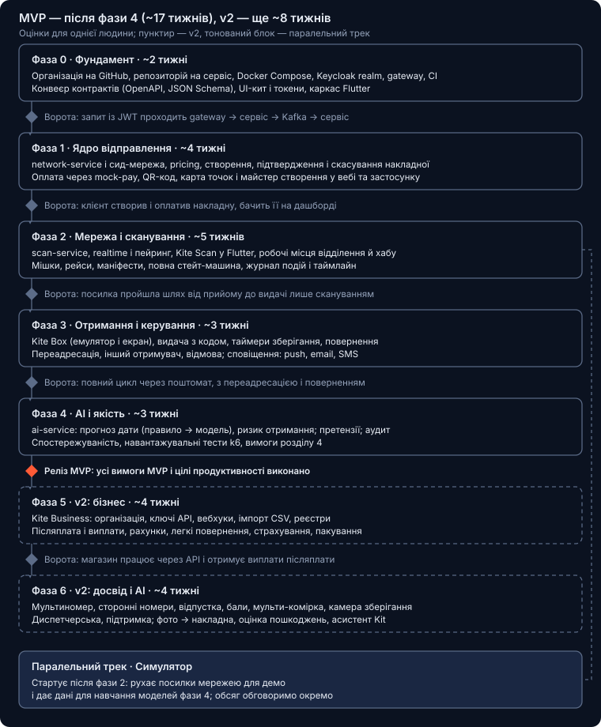

# 13 · Роадмап

> **Kite** — документація поштової системи · v1.4 · затверджено · 17.11.2026

MVP готовий після фази 4 — орієнтовно через 17 тижнів роботи однієї людини; v2 — ще близько 8 тижнів. Кожна фаза закінчується воротами: наскрізним сценарієм, який має працювати, перш ніж іти далі.

*роадмап · 7 фаз, ворота між ними, паралельний трек симулятора*

Ворота — це демо-сценарії, а не відсоток готовності: якщо фаза 2 не провела посилку від прийому до видачі лише скануванням, фаза 3 не починається.

---

[← 11 · AI-фічі](../06-ai/11-ai-fichi.md) · [Зміст](../README.md) · [14 · Глосарій і ухвалені рішення →](14-hlosarii-i-ukhvaleni-rishennia.md)
